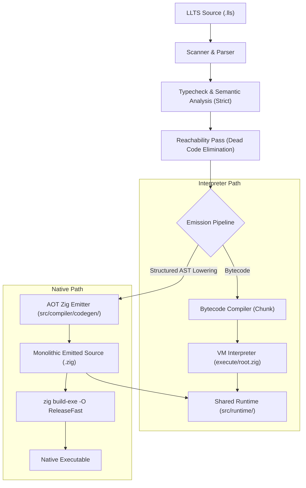

# Implementation Plan: Runtime-Driven Native Backend for LLTS

## Goal Description

Implement a native compilation target for LLTS by emitting **runtime-driven Zig code** that compiles via `zig build-exe` to produce standalone native binaries.

Unlike a high-level source-to-source transpiler (which delegates semantics, object lifetimes, and type rules to the Zig language compiler), this backend lowers LLTS code into **compiled runtime operations** that execute against a dedicated, shared **LLTS Runtime (`src/runtime/`)**. 

This approach achieves:
1. **Semantic Fidelity**: LLTS—not Zig—owns user code semantics. Memory watermarks, frame rewinding, packed heap layout in `bytes`, error returns, and numeric behavior behave identically in the native executable and the bytecode VM.
2. **Interpreter Dispatch Elimination**: Bytecode fetch, decode, and dynamic indirect jumps are replaced with native function calls, local variables, and static branch instructions.
3. **Zero External Dependencies**: Uses the existing host `zig` compiler without requiring LLVM C-API bindings or external C toolchains.
4. **LLVM Optimizations for Free**: Compiling the emitted runtime code with `zig build-exe -O ReleaseFast` allows LLVM to inline runtime primitives and optimize hot paths without LLTS needing to maintain an LLVM backend.

---

## Architectural Decisions & Soundness Guarantees

> [!IMPORTANT]
> **Core Architectural Principles**
> 1. **Strict by Default**: Native compilation assumes strict type soundness by default (`--strict` is preserved as a transitional gate for the VM/typechecker).
> 2. **CLI Commands**: We support both `llts emit-zig <file.lls> -o <out.zig>` (for inspecting generated runtime code) and `llts build <file.lls> --native -o <bin>` (for producing native executables).
> 3. **Dedicated `runtime/` Folder**: The runtime substrate is factored into `src/runtime/` (or root `runtime/`), cleanly separating reusable runtime primitives (heap, frames, memory, values, builtins) from the VM's bytecode interpreter loop.
> 4. **Runtime Code Emission (Not High-Level Zig)**: The emitter translates LLTS AST / ops into calls to the LLTS runtime environment rather than attempting to emit high-level idiomatic Zig constructs.

### The 4 Soundness Pillars

To prevent performance degradation and architectural impedance mismatches, the native backend is grounded on four strict design guarantees:

#### 1. Unboxed Native Locals vs. The "Stack Trap"
- **Problem**: Naively translating bytecode ops into software operand stack calls (`ctx.push(ctx.opAdd(ctx.pop(), ctx.pop()))`) destroys performance. CPU register allocation is defeated, and excessive memory round-trips occur.
- **Guarantee**: Since LLTS is strict and statically typed, all local variables and function parameters are lowered to **unboxed native Zig variables** (`var a: i64`, `const b: u8`).
- Operations on these locals invoke inline runtime helpers (`rt.arith.add(a, b)`, `rt.arith.addWrapped(rt.Width.i8, a, b)`), enforcing exact LLTS arithmetic and bounds semantics while allowing LLVM to place variables in CPU registers (`rax`, `rbx`) and vectorize loops.

#### 2. AST-Driven Structured Lowering (Post-Typecheck)
- **Problem**: Emitting from a flat bytecode `Chunk` forces the emitted Zig code into artificial basic blocks with `while/switch` or jump labels, obstructing LLVM branch optimization and vectorization.
- **Guarantee**: Emission runs after `analyze()`, `typecheck()`, and `reachability()`. The emitter walks the **analyzed, typed AST**, generating native structured control flow (`if/else`, `while`, `for`, `switch`) while calling runtime helpers for operations and memory access.

#### 3. RAII Frame Watermark Invariant via `defer`
- **Problem**: LLTS relies on frame watermarks (`heap_watermark` and `bytes_watermark`) to automatically rewind frame-allocated aggregates on function exit, with compile-time escape prevention.
- **Guarantee**: Every emitted function wraps its body with Zig's zero-cost native `defer`:
  ```zig
  pub fn lls_func_example(ctx: *rt.Context, a: i64) !i64 {
      const frame_mark = ctx.enterFrame();
      defer ctx.leaveFrame(frame_mark); // Guaranteed rewind on return, early return, or error exit

      const box = rt.allocFrame(ctx, Box{ .val = a });
      return box.val;
  }
  ```
  This provides provable semantic equivalence to the VM's `doReturn` frame cleanup without requiring custom exception unwinding.

#### 4. Monolithic Whole-Program Emission
- **Problem**: Emitting separate Zig files for each LLTS module introduces complicated cross-module build dependencies and inhibits compiler optimizations.
- **Guarantee**: The emitter processes all reachable modules identified by `reachability.zig` and emits a **single, unified `.zig` compilation unit**. This gives `zig build-exe -O ReleaseFast` full visibility for Whole-Program Optimization (WPO), dead-code stripping, and aggressive interprocedural inlining.

### LLTS-Owned Trap Reporting (Shadow Stack)

Native code runs on Zig's call stack, but LLTS must own failure output: a Zig
panic handler or Zig error-return trace must never be what the user sees. The
runtime therefore keeps a fixed **shadow stack** (`src/runtime/trace.zig`,
`Context.trace_stack`) mirroring LLTS calls, mirroring `VMState.frames`:

- `ctx.enterFunction(name, file)` — watermark + shadow push. At the frame cap
  (256, matching `MAX_FRAMES`) it traps with
  `Maximum call stack depth exceeded (256 frames)` (VM `TooManyFrames` parity).
- `ctx.setLine(line, col)` — `OP_LINE` equivalent; debug builds only.
- `ctx.leaveFunction(mark)` — shadow pop + watermark rewind, safe on every exit
  path.
- `rt.io.fail(...)` / `failMsg(...)` — print `Error: <msg>` then the trace
  (`    at fn (file:line:col)`, innermost first, VM `formatVmStackTrace`
  format) **before** returning the internal `error.RuntimeError` unwind signal.
  The emitted `main` glue is the only sink and exits 1.

The Zig error union is transport only; it is never printed or handled by Zig.
Release builds strip `setLine` calls exactly like the bytecode compiler strips
`OP_LINE`, so native traces degrade the same way VM release traces do (`?:?`
source positions).

---

## Technical Architecture



---

### Component: Runtime Architecture (`src/runtime/`) — **implemented (R1)**

The runtime is a **typed Zig API** — the native counterpart of the VM's
memory model, not a shared `Value` interpreter. The VM keeps its own copy
paths (`src/vm/**`); both share the width table so numeric semantics cannot
drift. No `Value`, no `VMState`, no dispatch tables.

#### `src/runtime/root.zig`
Top-level export for all runtime capabilities:
```zig
pub const Context = @import("context.zig").Context;
pub const io      = @import("io.zig");      // fd writes, fail(), failMsg(), exitProcess()
pub const mem     = @import("mem.zig");     // cloneBytes, concat, allocArray…
pub const arith   = @import("arith.zig");   // add/div/shl/typed ops/compare…
pub const err     = @import("err.zig");     // Error{code, payload}, eq()
pub const print   = @import("print.zig");   // VM-parity writeValue/print()
pub const widths  = @import("widths.zig");  // canonical Width table
pub const trace   = @import("trace.zig");   // shadow-stack frames + formatting
```

#### `src/runtime/context.zig`
Two-buffer bump heap with fixed capacity (pointers never move):
- `frame` — per-call scratch, rewound by `enterFrame`/`leaveFrame` marks.
- `immortal` — program-lifetime values (literals, concat results); never rewound.
- Defaults 16 MiB each (frame = VM packed cap `1<<20 * 16`); exhaustion = `error.OutOfMemory`.

#### `src/runtime/{arith,mem,err,print,io}.zig`
Typed ops with VM-exact trap messages and formats (verified against
`src/vm/execute/arith.zig`, `compare.zig`, `src/vm/builtins/print.zig`):
- `arith`: checked/wrapping `+ - *` (i64 + width-typed via i128), `@divTrunc`/`@rem`,
  wrapping `powi`, 0..63 shifts, bitwise, exact comparisons, f32/f64 paths (`@mod`, zero traps).
- `mem`: `cloneBytes` (`[]byte` value semantics), `concat` (immortal, `stringAdd` parity),
  `cloneArrayBytes`, `allocArray` (slice-length, no header).
- `err`: `Error{ code, payload: none|int|float|bool|str|agg }`; equality compares codes only.
- `print`: raw strings, printable-checked byte buffers, integer-array string heuristic,
  f64 exact-int special case, `Error: code — payload` rendering.
- `io`: libc `write`/`exit` (no `std.posix`/`std.process`); `fail()` / `failMsg()` print
  `Error: <msg>` then the shadow-stack trace and return `error.RuntimeError` — emitted
  `main` exits 1; LLTS `defer` is explicit-on-return (not Zig `defer`), so it never runs on traps.
- `trace`: fixed-capacity shadow stack (`MAX_FRAMES` = 256) with VM-parity frame formatting.

`src/runtime/widths.zig` owns the canonical `Width` table;
`src/compiler/widths.zig` re-exports it (keeping the `Value`-dependent helpers).

`ops.zig` from earlier drafts was replaced by `arith`/`mem`/`err`/`print`
and no longer exists.

---

### Component: Native Zig Codegen (`src/compiler/codegen/`)

Lowers analyzed LLTS AST into runtime-driving Zig functions.

#### `src/compiler/codegen/root.zig`
Entry point for the native emitter:
```zig
const std = @import("std");
const ast = @import("../../ast/root.zig");
const state_mod = @import("../state.zig");
const emitter = @import("emitter/root.zig");

pub const EmitOptions = struct {
    release: bool = false,
    runtime_path: []const u8 = "src/runtime/root.zig",
};

pub fn emitRuntimeZig(
    allocator: std.mem.Allocator,
    doc: *ast.Document,
    state: *state_mod.CompilerState,
    writer: anytype,
    options: EmitOptions,
) !void {
    var emit_ctx = try emitter.Emitter.init(allocator, doc, state, writer, options);
    defer emit_ctx.deinit();
    try emit_ctx.emit();
}
```

#### `src/compiler/codegen/emitter/`
The emitter is split by responsibility:
- **`root.zig`**: Shared `Emitter` state, diagnostics, naming, scope/binding lookup, type classification, and the emit entry point.
- **`unit.zig`**: Compilation-unit lowering — globals, function discovery/emission, top-level code, and the `pub fn main()` wrapper.
- **`prescan.zig`**: Statement termination analysis and the read/assigned pre-scan used for locals and unused-value silencing.
- **`stmt.zig`**: Statement and control-flow lowering (`@if`, `@switch`, `@for`, `break`, `continue`, assignments, declarations).
- **`expr.zig`**: Expression lowering, scalar arithmetic/comparisons, string operations, coercions, and calls. `lhs |> f(a)` desugars to the ordinary call `f(lhs, a)` (`emitPipe` builds a synthetic call node and delegates to `emitCall`) — pipes have no native runtime representation.

Behavior:
- **Imports & Setup**: Emits an absolute `@import("<runtime_path>")` and uses `rt.Context`.
- **Functions**: Each LLTS `@func` becomes `fn lls_fn_*(ctx: *rt.Context, ...) anyerror!RetType`.
- **Unboxed Variables**: Parameters and local bindings emit as typed native variables (`var x: i64 = ...`).
- **Watermark RAII**: Wraps every function body with `const mark = try ctx.enterFunction(name, file); defer ctx.leaveFunction(mark);`.
- **Top-Level Code**: Emits `lls_top_level(ctx)` initializing globals and running top-level statements.
- **Entry Wrapper**: Emits `pub fn main() void` initializing `rt.Context`, running top-level code and LLTS `main`, and mapping errors to process exit.
- **Control Flow**: `@if`, scalar `@switch`, range `@for (start..end) |i|`, condition `@for (cond)`, and iterable `@for` over arrays/slices/strings lower to native structured Zig. Value-producing arms and labeled blocks use labeled-block results and `break` payloads; loop `break`/`continue` preserve labels. Optional `@if`/`@for` captures unwrap through Zig optional captures. Switch scrutinees are evaluated once and prongs use the same runtime equality helpers as the VM. Conditions rely on the LLTS typechecker's guarantees; the emitter adds no runtime truthiness or type assertions.
- **Aggregates & Pointers**: Structs lower to typed Zig structs with stable field names; fixed arrays, slices (including heap-allocated slice literals), optionals, and pointers use their native Zig representations. Struct fields, array/slice indexing, slicing, `len`, optional unwrap, address-of `&`, and `@addrOf` are lowered; slice assignment clones to match VM value semantics. `@addrOf` yields the native address as `i64`; `print(@addrOf(x))` renders the raw pointer in hex (native-only).
- **Errors**: Error values use `rt.err.Error`; error unions lower to `rt.err.Result(T)`. `error(...)`, `?`, `return` coercion, `@isError`, `@nameOf`, `.code`/`.message`/`.payload`, equality, `@switch` over narrowed errors, and error printing match the VM. Error-set typedefs are expanded during classification.
- **Cleanup**: `@defer` and `@errdefer` are tracked explicitly per lexical scope and emitted LIFO on scope exit, `break`, `continue`, and `return`, so they never run on runtime traps. `@errdefer` runs only on error returns.
- **Remaining**: `@new` and struct printing.

---

### Component: CLI & Pipeline (`src/cli/` & `src/pipeline.zig`)

#### `src/cli/root.zig`
1. Add `emit-zig` command:
   ```bash
   llts emit-zig <file.lls> -o <out.zig>
   ```
2. Update `build` command with `--native` / `-n`:
   ```bash
   llts build <file.lls> --native -o <output_binary>
   ```

#### `src/pipeline.zig`
1. `emitZigCode(allocator, path, source, writer, options)`: scan → parse → strict `compiler.analyze` → `emitRuntimeZig` into any writer.
2. `compileNativeBinary(allocator, path, source, out_binary_path, options)`:
   - Emits the runtime Zig code and stages it as `.llts_native_<timestamp>.zig` in the cwd — zig's root module path is the root file's directory, and the emitter resolves the runtime `@import` against the cwd, so the staged file must live under it. The staged file is deleted after the build.
   - Spawns `zig build-exe <temp.zig> -lc` with one `-femit-*` artifact flag selected by the emit mode: `-femit-bin=<out>` (default), or via `--emit=<kind>`/`--emit-asm` any of `emit-asm`, `emit-llvm-ir`, `emit-llvm-bc`, `emit-h`, `emit-docs`, `emit-implib` (each with `-fno-emit-bin`, and `-fllvm` where the self-hosted backend has no printer — asm — or zig requires LLVM extensions — llvm-ir/llvm-bc). `-O <mode>` (`--optimize`/`--release`), `-target <triple>`, and any `--zig-args` are forwarded.
   - On nonzero exit (or a failed spawn), zig's stderr is printed, the `diag` API is marked (so the CLI does not double-report), and `error.NativeBuildFailed` is returned.

#### `src/compiler/llvm/root.zig`
Cleanly remove the inactive LLVM stub module.

---

## Phased Implementation Roadmap

1. **Phase 1: Runtime Decoupling (`src/runtime/`)** — ✅ **done (R1)**
   - Typed native API (`Context`, `arith`, `mem`, `err`, `print`, `io`, `widths`, `trace`)
     — deliberately **not** a shared `Value` extraction; the VM keeps its own paths.
   - Two-buffer (frame + immortal) bump heap with stable pointers.
   - LLTS-owned trap reporting via the shadow stack (`trace.zig`, `enterFunction`/`leaveFunction`/`setLine`).
   - VM-parity trap messages and print formats, unit-tested
     (`src/runtime/tests.zig`, wired into `zig build test`).
   - The VM continues to function unchanged on its own copy paths.

2. **Phase 2: Emitter Core & `llts emit-zig`** — implemented for the basic subset
   - `src/compiler/codegen/emitter/` generates runtime-driving Zig for arithmetic, functions, returns, locals, strings, top-level code, and `print`.
   - Pipes (`|>`) over direct callees desugar to ordinary calls in the emitter and match the VM output; method pipes (`lhs |> obj.method`) fail cleanly with the Phase 2 direct-calls-only error until method calls are lowered.
   - `llts emit-zig <file.lls> -o <out.zig>` is wired (strict mode on by default).
   - Generated files are verified by `tests/55_emit_zig.test.ts` (emit → `zig run -lc` → compare against the VM); pipe parity is covered in `tests/56_pipe_expr.test.ts` (native section).
   - Generated Zig must reside inside the repo module root so the absolute runtime import resolves; Phase 4 `zig build-exe` remains.

3. **Phase 3: Control Flow, Loops, and Heap Operations** — control flow, aggregates, and `@defer` implemented
   - Structured `@if` / `@else @if` / `@else` lowering, including value-producing arms via labeled-block results and `break` payloads.
   - `@switch` on integers, floats, booleans, and strings, including multi-pattern prongs, `@else`, and value-producing arms.
   - Range `@for (start..end) |i|`, condition `@for (cond)`, iterable `@for` over arrays/slices/strings, and optional captures with labeled `break`/`continue` and wrapping counter increments.
   - Struct fields, fixed arrays, slices/slice literals, optionals, pointers/address-of, member/index assignment, and `len` lower to typed Zig values.
   - `@defer` runs LIFO on scope exit, `break`, `continue`, and `return`.
   - Labeled block values lower to Zig labeled blocks; `break :label value` runs pending defers before yielding.
   - `@addrOf` lowers to native addresses; direct printing uses raw hex (native-only).
   - Remaining: `@new` and struct printing.
   - Enforce RAII frame watermark cleanup in all emitted functions.

4. **Phase 3.5: Error Semantics** — implemented
   - `error(...)` values and payloads, custom `@error` sets and unions, error-set typedefs, error-union `?` propagation, and implicit `.ok` wrapping.
   - `@isError` narrowing, `@nameOf`, `.code`/`.message`/`.payload`, error equality, `@switch` over narrowed errors, and error printing.
   - `@errdefer` interleaves with `@defer` in LIFO order and runs only on error exits.
   - Unhandled errors from `main` and top-level code print `Error: <code>` and exit nonzero.
   - Covered by `tests/55_emit_zig.test.ts` native parity tests.

5. **Phase 4: Full Native Compilation (`llts build --native`)** — implemented
   - `compileNativeBinary` in `src/pipeline.zig` emits the runtime unit, stages it in the cwd, and spawns `zig build-exe` with the `-femit-*` flag for the selected artifact (`bin`, `asm`, `llvm-ir`, `llvm-bc`, `h`, `docs`, `implib` via `--emit=<kind>`); the staged file is removed afterwards.
   - Supports `-O Debug` / `-O ReleaseFast` / `--target` / `--zig-bin` / `--zig-args` passthrough; zig's stderr surfaces on failure as `error.NativeBuildFailed`.
   - Verified end-to-end by `tests/57.1_native_binary.test.ts` (binary-vs-VM stdout/exit-code parity, staging cleanup), `tests/57.2_native_artifacts.test.ts` (asm/llvm-ir/docs emission), and `tests/57.3_native_emit_errors.test.ts` (implib Windows-only rejection, unknown-kind validation).

6. **Phase 5: Conformance Testing & Parity**
   - Run the Bun test suite across both the bytecode VM runner and the native binary runner to ensure 100% output and error parity.

---

## Verification Plan

### Automated Tests
1. **Runtime Operation Tests**:
   - `zig test src/runtime/tests.zig`: Test that runtime ops perform checked arithmetic, byte packing, and frame rewinds correctly.
2. **Emitter Golden Tests**:
   - Emit runtime Zig for test fixtures and compile them using `zig test`.
3. **End-to-End Parity Tests**:
   - Execute both bytecode and native binary on identical `.lls` inputs and compare:
     - Standard output
     - Standard error
     - Exit codes
   ```bash
   ./zig-out/bin/llts run examples/hello-world.lls > /tmp/vm.out
   ./zig-out/bin/llts build examples/hello-world.lls --native -o /tmp/hello_native
   /tmp/hello_native > /tmp/native.out
   diff /tmp/vm.out /tmp/native.out
   ```
4. **Bun Test Suite**:
   - Run the full test suite with `--native` configuration:
     ```bash
     bun test tests/
     ```

### Manual Verification
- Emit a Phase 2 program (generated file stays under the repo module root):
  ```bash
  ./zig-out/bin/llts emit-zig examples/functions.lls -o .tmp_functions.zig
  cat .tmp_functions.zig # Inspect readable runtime calls
  zig run -lc .tmp_functions.zig
  rm .tmp_functions.zig
  ```
- `examples/hello-world.lls` needs Phase 3 (imports, structs, methods, control flow).
